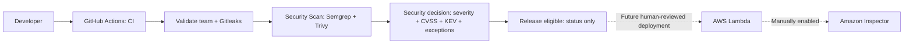

# Security decisions in the existing CI



**Implemented:** one CI workflow; existing checks; validated assembly handoff;
real scanners; raw JSON, CycloneDX SBOMs and job summaries; six safe synthetic
scenarios; a genuine-only release eligibility status. **No deployment, AWS
credentials, OIDC, Inspector activation or infrastructure changes are included.**

## Run the interview demonstration (15–20 minutes)

1. Open [Actions → CI](https://github.com/slyncon/cdk-team-a/actions/workflows/ci.yml).
   Select **Run workflow**, branch **main**, choose **scenario**, then **Run workflow**.
   Each run starts with the original `Validate team` checks. Allow a few minutes.
2. Start with `clean`. Open the completed run's **Summary** and the Security Scan
   report: **SYNTHETIC / PRESENTATION ONLY**, **PASS**, release eligible **No**.
3. Run `high-cvss`: show CVSS **9.8 (v3.1)** and the expected red **BLOCK**.
4. Run `kev`: show **Medium**, **Yes (MOCKED)** and **BLOCK**. The fictional CVE
   comes from an explicitly mocked catalog, never the real CISA feed.
5. Compare `exception-approved` (**ALLOW WITH EXCEPTION**, finding still visible)
   with `exception-expired` (**BLOCK**). Show owner, independent reviewer and expiry.
6. Show `combined-risk`: the same report explains both blocking reasons.
7. Run `real`: show actual scanner results, coverage and downloadable evidence.
   Explain the current High IaC finding below; this is an honest blocked release.
   Finish with Inspector's planned role after a future human deployment.

| Scenario | Data | Expected Security Scan | Release eligible |
|---|---|---|---|
| `real` (default) | Actual source, validated assembly, live advisories/CISA | Depends on findings; currently BLOCK | Passes only if real policy approves; otherwise fails |
| `clean` | SYNTHETIC / PRESENTATION ONLY | PASS (green) | Withheld |
| `high-cvss` | SYNTHETIC / PRESENTATION ONLY, Critical / 9.8 | BLOCK (red, expected) | Withheld |
| `kev` | SYNTHETIC / PRESENTATION ONLY, Medium / mocked KEV | BLOCK (red, expected) | Withheld |
| `exception-approved` | SYNTHETIC / PRESENTATION ONLY, High / scoped approval | ALLOW WITH EXCEPTION (green) | Withheld |
| `exception-expired` | SYNTHETIC / PRESENTATION ONLY, expired approval | BLOCK (red, expected) | Withheld |
| `combined-risk` | SYNTHETIC / PRESENTATION ONLY, Critical + mocked KEV | BLOCK (red, expected), both reasons | Withheld |

Automatic push, PR and Monday schedule runs always select `real`. Synthetic runs
still validate the application but skip real scanners in Security Scan. They use
the same decision function with isolated fixtures and can **never** authorize
release eligibility. No vulnerable packages, unsafe application code or secrets
were added for this presentation. The fake CVEs are not claims about real products.

## What is scanned and what the evidence proves

- **Semgrep CE 1.181.0:** handler, `app.py`, `stack.py` and Python scripts. Uses
  94 official [Python language security rules](https://github.com/semgrep/semgrep-rules/tree/9bbf021d0acffa3095fcffd17b2bc7787eb4796d/python/lang/security),
  including injection, deserialization, cryptography and dangerous API rules.
  Engine is local, no account/token; rules are pinned to an immutable commit and
  checksum. All configured findings block; scan errors block separately. The
  security job uses Python 3.13 (avoids a local Python 3.12 Semgrep startup crash);
  application validation and Lambda still use Python 3.12. CE has limited dataflow
  analysis; this is not comprehensive application security assurance.
- **Trivy 0.76.0:** all 58 hashed Python build/dev/SDK dependencies plus the npm
  CDK CLI (including dev dependencies). A staged `requirements.txt` is an exact
  copy of `requirements.lock`, so Trivy recognizes its filename. Coverage checks
  require every expected package/version in the report, plus a nonempty SBOM.
  The pinned Platform Git source is recorded as provenance; Trivy does not map
  that private application package/source revision to a package advisory feed.
- **Actual Claims asset:** CDK's assembly contains `asset.<hash>/index.py`,
  marked for ZIP packaging at publishing time; **there is no packaged ZIP or
  installed third-party runtime dependency in this assembly**. The security job
  verifies its handler bytes against checked-out source, inventories it, runs
  Trivy on that staged directory and generates a separate runtime CycloneDX SBOM.
  Zero runtime components is expected and explicitly checked against this
  source-only contract. It is not proof of scanning an installed SDK. AWS-provided
  `boto3`/`botocore`, the managed Python runtime and service patches are outside
  this CI inventory. Adding vendored packages/layers requires updating packaging
  and the coverage contract, not accepting an empty scan. CDK's inline S3
  notification helper is covered by template policy, not by handler SAST.
- **IaC:** the validated synthesized Claims CloudFormation template, including
  helper resources. Actual successful and failed checks must appear; passed
  checks are never findings. Existing Platform and assembly validators remain.
- **Artifacts:** separate `security-REAL-…` / `security-SYNTHETIC-…` downloads, plus
  the original assembly. Real evidence includes raw scanner JSON, both SBOMs,
  verified CISA snapshot, scanner exit statuses, coverage, decision and summary.
  Only vulnerability/misconfiguration scanners run in Trivy; no credentials or
  machine environment dumps are included. Retention is seven days. Advisory and
  IaC databases evolve, so genuine results may change over time.

There are no application containers; image scanning is not applicable. Existing
Gitleaks scans history. Bandit, pip-audit and npm audit remain: they overlap SAST
and dependency checks but retain existing independent coverage and early failures.
Their existing hard gates remain stricter: pip-audit blocks any advisory and npm
audit blocks High/Critical, even if the new Trivy gate could accept an exception.
A new-gate exception cannot override failed validation. The presentation simulates
approval without weakening those existing checks; aligning their policies with
one exception authority would need a separately reviewed coverage change.

**Current real baseline (15 October 2026):** zero dependency CVEs. Semgrep reports
`httpsconnection-detected`, a Medium audit notice about version-dependent TLS
defaults in the existing GitHub-check helper. The helper now enforces a fixed
HTTPS GitHub host; Python 3.12 verifies certificates by default. This notice is
not a confirmed TLS defect, but still blocks under the conservative all-rules
policy; it was not suppressed. Trivy IaC
reports **AWS-0132 High**, S3 encryption should use a customer-managed KMS key.
The existing bucket has AES256/S3-managed encryption, public-access blocking and
TLS enforcement. Both findings intentionally block: no rule downgrade or exception
was added to turn it green. Four Low and one Medium IaC findings remain visible
(log encryption, tracing, access logging, versioning). Changing to KMS would
require a separately reviewed infrastructure/permission change. No AWS change
was made. See the latest real run for authoritative current results.

## Decision policy and exceptions

Critical/High scanner severity blocks; any supplied numeric CVSS score >=7 also
blocks, even if a vendor labels the finding lower. CVSS normally calls 7.0–8.9
High and 9.0–10.0 Critical. Reports retain score source/version, using the vector
version when provided, or `3.x` if unspecified. Missing CVSS stays **Not provided**;
IaC and Semgrep severity are not fabricated numeric CVSS scores. Medium/Low
dependency and IaC findings are visible but allowed, unless in KEV. Semgrep's
ERROR/WARNING/INFO map to High/Medium/Low for reporting; **all configured security
rule findings block**. Raw findings determine the decision, not terminal colors.

The job downloads the [official CISA KEV JSON catalog](https://www.cisa.gov/sites/default/files/feeds/known_exploited_vulnerabilities.json)
over HTTPS. It validates CVE IDs, count, catalog version and publication date
(maximum age 30 days), then matches discovered CVE IDs. Retrieval/validation
failure blocks. KEV matches block at every severity and cannot be waived. The
six synthetic scenarios instead use an explicitly mocked catalog in
`security/scenarios.json`; real mode never reads that file.

`security/trivyignore.yaml` uses [Trivy's native ignore schema](https://trivy.dev/docs/latest/configuration/filtering/)
in JSON syntax (valid YAML), initially empty. Each exception must have native
`id`, exactly one `paths` entry, `statement`, `expired_at`, plus
`component`, `owner`, `approved_by` metadata. Copy the exact component and scope
from the real decision report. For IaC, the component includes the resource
location; for a vulnerability it is the package name. The gate checks ID,
component and path, complete justification, distinct owner/reviewer, and expiry
strictly after today (UTC in Actions). In JSON/YAML use an explicit UTC midnight
timestamp such as `2026-12-31T00:00:00Z`: Trivy 0.76's JSON-encoded native dates
require RFC3339. Date-only quoted JSON strings fail the native parser and block.
A changed location requires new review.
Trivy's native filtering is used for readable output with suppressed findings
shown; the gate always reads **unsuppressed raw JSON** for severity and KEV.
An exception cannot waive KEV, SAST, secrets or scanner/evidence failures.

Names in JSON **do not authenticate approval**. Require protected branches,
CODEOWNERS review and an independent security reviewer on GitHub before trusting
exceptions. The repository currently lists its owner, not an independent
security team. Configure that team/review enforcement manually. Demo approvals
are expressly fictional; no real exception is approved by this assignment.

## When a check fails and what enforces it

Open the job summary and download its evidence. Fix the named code issue, upgrade
the affected package or review the IaC finding. If the problem is a scanner,
missing report, incomplete coverage or stale/unavailable intelligence, repair it
and rerun; do not waive it. A justified temporary vulnerability/IaC exception
needs exact scope, mitigation, owner, independent approval and expiry. Never
interpret an expected red synthetic demonstration as a broken installation.

Manually require **Validate team**, **Security Scan** and **Release eligible** on
`main`, require up-to-date checks and CODEOWNERS/independent reviews, and restrict
bypasses. Genuine `Release eligible` runs even after upstream failure and fails
unless validation and security both approve. Synthetic runs emit a differently
named `SYNTHETIC - no release approval` check and record refusal of approval.
Their success never replaces the required genuine check. A skipped genuine job
would count as successful in GitHub protection, which is why it fails explicitly.
Branch protection is currently **not configured**
(verified via GitHub API); the workflow does not configure it. Future deployment
jobs must depend on genuine eligibility and bind deployment to the verified SHA
and assembly digest; future IAM roles must trust only the protected deployment
path. Today's human SSO deployment can bypass CI: this status alone is not AWS
enforcement. There is no new deploy capability or AWS identity in this workflow.

Amazon Inspector complements CI by [continuously assessing eligible deployed
Lambda functions and their layers](https://docs.aws.amazon.com/inspector/latest/user/scanning-lambda.html)
as vulnerability information changes. Activation, eligibility/runtime coverage
and findings must be checked in the AWS console by the owner after deployment.
Inspector is **planned/manual and unverified here**, and never needed for this
GitHub demonstration. Standard scanning also [excludes the default AWS SDK](https://docs.aws.amazon.com/inspector/latest/user/scanning_resources_lambda.html);
it will not fill this application's unbundled SDK inventory gap. It does not
replace IaC checks or secure code review.

## Local verification

Run all existing README checks. Then install the scanner tools with Python 3.13
on Linux amd64 and run (all scans are credential-free; downloads need internet):

```bash
python scripts/security_prepare.py  # existing validated .build/cdk.out required
bash scripts/security_tools.sh
export PATH="$PWD/.build/security-tools:$PATH"
bash scripts/security_scan.sh
python scripts/security_gate.py     # exit 1 for the current genuine High finding
python scripts/security_gate.py --scenario clean
python scripts/security_gate.py --scenario combined-risk  # expected exit 1
```

Use a separate scanner virtual environment to preserve the hashed application
environment. `pytest` covers all six demos, scope/approval/expiry checks, KEV
non-waivability, numeric CVSS, missing/empty evidence, intelligence validation,
infrastructure findings and synthetic release isolation. No AWS calls are made.
