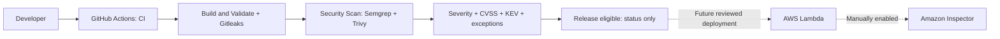

# Security scans and policy scenarios



One workflow preserves existing checks and passes a verified CDK assembly to
Security Scan. It provides actual scanners, JSON evidence, CycloneDX SBOMs and
selectable synthetic scenarios. No deployment, AWS credentials, OIDC, Inspector
activation or infrastructure changes are included.

## Run a scenario

Open [Actions → CI](https://github.com/slyncon/cdk-team-a/actions/workflows/ci.yml),
select **Run workflow → main**, choose **scenario**, then **Run workflow**.
Build and Validate runs first. The single job summary is published by
**Security Scan**, with the selected scenario in its title. Tests and Gitleaks
retain their logs without publishing additional summaries.

| Scenario | Input | Expected Security Scan | Release approval |
|---|---|---|---|
| `real` (default) | Actual source, assembly and live CISA catalog | Depends on findings; currently BLOCK | Only genuine approved runs |
| `clean` | Synthetic, no findings | PASS | Withheld |
| `high-cvss` | Synthetic Critical, CVSS 9.8 | BLOCK | Withheld |
| `kev` | Synthetic Medium, mock KEV match | BLOCK | Withheld |
| `exception-approved` | Synthetic High, valid scoped exception | ALLOW WITH EXCEPTION | Withheld |
| `exception-expired` | Synthetic High, expired exception | BLOCK | Withheld |
| `combined-risk` | Synthetic Critical plus mock KEV match | BLOCK, both reasons | Withheld |

The synthetic inputs exercise the same policy function, skip real scanners and
never grant release approval. They use mock CVEs/catalog data from
`security/scenarios.json`. Automatic push, PR and Monday scheduled runs always
select `real`. No vulnerable packages, secrets or unsafe application code were
added to produce these scenarios. Red BLOCK results are intentional.

For a short walkthrough: show `clean`, then `high-cvss` and `kev`; compare the two
exception cases; show both reasons in `combined-risk`; finish with `real` and its
downloadable reports. The mocked KEV match is not a claim about the CISA catalog.

## Coverage and evidence

- **Semgrep CE 1.181.0:** nine Python files covering the handler, CDK entry point,
  stack and scripts. Uses 94 pinned official [Python security rules](https://github.com/semgrep/semgrep-rules/tree/9bbf021d0acffa3095fcffd17b2bc7787eb4796d/python/lang/security).
  All configured findings block; engine errors also block. No account is required.
  The scanner uses Python 3.13; application validation/Lambda retain Python 3.12.
- **Trivy 0.76.0:** all 58 hashed Python build/dev/SDK packages and the npm CDK CLI,
  including dev dependencies. A copy of `requirements.lock` named
  `requirements.txt` enables Trivy discovery. Every expected package/version must
  appear in the report. Platform's pinned Git revision is retained as provenance;
  that source package has no package-advisory mapping in this integration.
- **Lambda artifact:** the assembly contains `asset.<hash>/index.py`, staged for
  ZIP packaging during publication. There is no ZIP or installed third-party
  package in this assembly. Handler bytes must match source. Trivy inspects this
  staged directory and emits a separate runtime SBOM; zero dependency components
  reflects the verified source-only inventory. AWS-provided boto3/botocore and
  Python runtime versions are outside this inventory. Vendoring dependencies or
  adding layers requires updating the coverage contract. CDK's inline notification
  helper is checked through infrastructure policy rather than handler SAST.
- **IaC:** Trivy evaluates synthesized CloudFormation, including helper resources.
  Existing Platform and assembly policy checks remain. Successful checks are not
  counted as findings; an empty scan cannot approve a release.

There are no application containers, so image scanning is not applicable.
Gitleaks scans history. Bandit, pip-audit and npm audit retain their independent
checks. Their inherited hard gates are stricter: pip-audit blocks any advisory
and npm audit blocks High/Critical, even when a new-gate exception might apply.
Exceptions do not override failed Build and Validate checks.

Each real scanner, SBOM generation, report conversion and CISA retrieval has a
separate named Actions step using a shared Make target. Scanner exit codes remain
in `status.tsv`. Raw JSON always retains unsuppressed findings. Artifacts contain
reports, both SBOMs, CISA snapshot, coverage, decision and summary; synthetic
reports are stored separately. Retention is seven days. Databases change over
time, so genuine scan outcomes may change.

**Current baseline (15 October 2026):** zero dependency CVEs; Trivy reports
AWS-0132 High because the bucket uses S3-managed AES256 rather than a
customer-managed KMS key. Four Low and one Medium IaC findings remain visible
(log encryption, tracing, access logging and versioning). Semgrep reports the
Medium `httpsconnection-detected` audit notice in the GitHub-check helper. The
helper enforces HTTPS to a fixed host and Python 3.12 verifies certificates;
the notice is not a confirmed TLS defect, but the configured policy blocks it.
Neither rule was suppressed. KMS changes and policy tuning require review.

## Policy and exceptions

High/Critical severity or any supplied CVSS score >=7 blocks. CVSS normally calls
7.0–8.9 High and 9.0–10.0 Critical. Reports preserve the score's source/version;
missing scores remain absent. Medium/Low dependency and IaC findings are allowed
by this gate unless KEV applies. Semgrep ERROR/WARNING/INFO map to High/Medium/Low
for reporting, and all configured security findings block.

The [official CISA catalog](https://www.cisa.gov/sites/default/files/feeds/known_exploited_vulnerabilities.json)
requires valid CVE IDs, matching count, catalog version and publication date no
more than 30 days old. Matching discovered CVEs block regardless of severity.
Unavailable/invalid intelligence, scanner failures or missing evidence block.

`security/trivyignore.yaml` uses Trivy's native schema in JSON syntax (valid YAML),
initially empty. An exception needs `id`, exactly one `paths` entry, `component`,
`statement`, `owner`, independent `approved_by` and future `expired_at`.
Copy the exact package/resource and path from the report. JSON-encoded native
expiry requires a UTC midnight timestamp such as `2026-12-31T00:00:00Z`.
Trivy displays scoped suppression, but the gate evaluates raw findings so KEV
cannot be hidden. KEV, SAST, secrets and scanner failures cannot be waived.
Names in a file do not authenticate approval: protected review must enforce it.

## Failure handling and enforcement

Read the selected scenario's Security Scan summary and evidence. For real runs,
fix the named package/code/IaC issue or repair the failed scanner and rerun.
Request a reviewed, scoped, expiring exception only when justified.

Manually require **Build and Validate**, **Security Scan** and **Release eligible**
on main, with up-to-date checks, CODEOWNERS/independent review and restricted
bypasses. Branch protection is not configured by this workflow. Genuine release
checks fail explicitly when blocked. Synthetic runs use the distinct
**Release withheld** check, so their success cannot replace real approval.
Future deployment jobs/roles must bind approval to the verified commit and
assembly digest. Human SSO deployment can still bypass this CI status today.
The archived deployment helper checks all three current status names but remains
inactive and is not ready to restore as a deployment system.

Inspector is manually activated by the owner after deployment and is unverified
here. It complements CI by checking eligible deployed Lambda dependencies/layers
as advisories change. Its [standard scan excludes the default AWS SDK](https://docs.aws.amazon.com/inspector/latest/user/scanning_resources_lambda.html),
so it does not fill this application's unbundled SDK inventory gap.

## Local commands

Use the existing Python 3.12 application environment for `make validate` and
Node 24. Use a separate Python 3.13 scanner environment on Linux AMD64; downloads
need internet access, but no AWS credentials are needed. Start with a validated
`.build/cdk.out` assembly, then:

```bash
make security-tools
make security                 # actual scans; current policy BLOCK is expected
make security-decision SCENARIO=clean
make security-decision SCENARIO=combined-risk  # expected nonzero exit
```

The Makefile also exposes individual tasks (`lint`, `test`, `audit`, `synth`,
`semgrep`, `trivy-dependencies`, `trivy-iac`, `trivy-runtime`, `sbom`, `reports`,
`kev`). `security-prepare` clears old inputs/reports before a new real scan.
Tests isolate GitHub output paths so their scenarios never publish job summaries.
